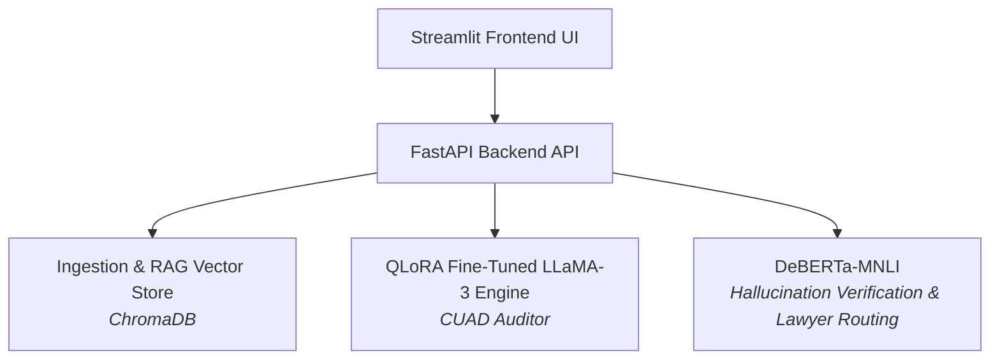

# LegalSeva — AI-Powered Legal Contract Auditor & Compliance Platform

**LegalSeva** is an enterprise-grade contract auditing and legal intelligence platform designed specifically for remote version control, fast execution, and strict regulatory alignment with **EU AI Act Annex III** documentation standards. 

The core engine leverages a 4-bit QLoRA fine-tuned **LLaMA-3-8B** model for legal clause extraction, **ChromaDB** for vector-based Retrieval-Augmented Generation (RAG), and a **DeBERTa-large-mnli** NLI verification guardrail to actively prevent legal hallucinations and route high-risk agreements to human legal counsel.

---

## Architectural Overview


---

## Key Features & Engineering Highlights

* **Fine-Tuned Clause Extraction:** QLoRA 4-bit fine-tuned LLaMA-3-8B model trained against the **CUAD** (Contract Understanding Atticus Dataset) across 41 risk categories (ROUGE-L: ~0.4119).
* **NLI Hallucination Verification:** Integrates `DeBERTa-large-mnli` to verify generated summaries against source text, maintaining factual hallucination rates ≤ 0.15.
* **Automated Lawyer-Routing Policy:** Automatically flags contracts with unverified claims (`hallucination_rate > 0.20`) or self-consistency conflicts, marking them with `mandatory_lawyer_review = True`.
* **Source Sentence Attribution:** Calculates TF-IDF and embedding similarity to attribute claims back to the exact top-3 contract source clauses.
* **EU AI Act Annex III Package:** Fully compliant high-risk AI documentation (`COMPLIANCE_ANNEX_III.md`), mandatory non-legal advice disclaimer banners, and audit log generation.
* **MLOps Lineage & Privacy Tracking:** Logs contract statistics, clause distributions, and evaluation runs without storing raw user contract text (`src/mlops_tracker.py`).

---

## Tech Stack

* **Large Language Model:** LLaMA-3-8B (QLoRA 4-bit quantized)
* **NLI Guardrails:** DeBERTa-large-mnli
* **Vector Store / RAG:** ChromaDB
* **API Framework:** FastAPI & Uvicorn
* **Frontend Interface:** Streamlit
* **Containerization:** Docker
* **Language & MLOps:** Python 3.10+, PyTorch, HuggingFace Transformers, MLflow

---

## Repository Structure

```text
legal-llm-contract-review/
├── src/
│   ├── attribution.py        # Sentence attribution & similarity scoring
│   ├── chunking.py           # Contract text chunking pipeline
│   ├── config.py             # System configuration parameters
│   ├── data_loader.py        # Data loading utilities
│   ├── dataset_builder.py   # CUAD dataset formatting pipeline
│   ├── guardrails.py        # Lawyer routing and hallucination policy
│   ├── main.py               # FastAPI application endpoints
│   ├── prepare_cuad.py       # Pre-processing scripts for CUAD
│   ├── preprocess.py         # Text cleaning and normalization
│   ├── rag_engine.py         # RAG query retrieval pipeline
│   └── vector_store.py       # ChromaDB vector store wrapper
├── app.py                    # Streamlit web user interface
├── COMPLIANCE_ANNEX_III.md   # EU AI Act Annex III compliance documentation
├── Dockerfile                # Production container deployment definition
├── .dockerignore             # Docker build exclusion rules
├── .gitignore                # Git repository tracking rules
├── requirements.txt          # Python dependencies
├── evaluate_cuad.py          # CUAD evaluation suite
├── evaluate_cuad_accuracy.py # Accuracy evaluation script
├── evaluate_summarization.py# ROUGE & NLI summarization benchmarks
├── inference.py              # CLI inference tester
├── ingest_cuad.py            # Vector ingestion script
├── train_qlora.py            # QLoRA fine-tuning pipeline
└── verification.py           # NLI verification tests
```
---

## Quick Start & Deployment Guide

### Prerequisites
* Python 3.10 or higher
* Git

### Option 1: Local Virtual Environment (`venv`)

1. **Clone the Repository**
   ```powershell
   git clone [https://github.com/MasterOm08/LegalSeva.git](https://github.com/MasterOm08/LegalSeva.git)
   cd LegalSeva

2. **Activate Virtual Environment**
    ```powershell
    # Windows PowerShell
    .\venv\Scripts\Activate.ps1

    # Linux/macOS
    # source venv/bin/activate
    ```

3. **Install Dependencies**
    ```powershell
    pip install -r requirements.txt
    ```

4. **Launch Backend API Server**
    ```powershell
    python -m uvicorn src.main:app --reload --port 8000
    ```

5. **Launch Frontend Streamlit App (In a second activated terminal window)**
    ```powershell
    .\venv\Scripts\Activate.ps1
    streamlit run app.py
    ```

---

### Option 2: Docker Container Deployment

1. **Build Docker Image**
    ```powershell
    docker build -t legalseva-backend .
    ```

2. **Run Container**
    ```powershell
    docker run -d -p 8000:8000 --name legalseva_app legalseva-backend
    ```
---
## API Reference & Usage

### 1. Model & Compliance Information
`GET /model-info`

Returns active model metadata, fine-tuning details, supported CUAD categories, and safety disclaimers.

---

### 2. Upload & Ingest Contract
`POST /api/v1/process-contract`

Chunks and indexes an uploaded contract file (`.txt` or `.pdf`) into the local vector store.

**PowerShell Command Example:**
```powershell
curl.exe -X POST "http://localhost:8000/api/v1/process-contract" -F "file=@test_contract.txt"
```

---

### 3. Analyze Clause against Playbook Rule
`POST /api/v1/analyze`

Executes clause audit, RAG retrieval, NLI verification, attribution scoring, and lawyer-routing decisions.

**PowerShell Request Example:**
```powershell
Invoke-RestMethod -Uri "http://localhost:8000/api/v1/analyze" `
  -Method Post `
  -ContentType "application/json" `
  -Body (@{
      query = "Either party may terminate this Agreement upon thirty (30) days written notice."
      playbook_rule = "Check for standard termination notice period requirements."
  } | ConvertTo-Json)
```

**Response Format Example:**
```json
{
  "analysis": "### FACTUAL CLAUSE ANALYSIS...",
  "hallucination_metrics": {
    "hallucination_rate": 0.0,
    "sentence_results": []
  },
  "lawyer_routing": {
    "mandatory_lawyer_review": false,
    "tag": "Verified",
    "flag_reasons": []
  },
  "sources": [
    "[Score 0.175]: This contract shall automatically renew..."
  ],
  "disclaimer": "⚠️ NOT FOR LEGAL ADVICE — FOR INFORMATIONAL & AUDITING PURPOSES ONLY"
}
```
---

## Legal Disclaimer & Regulatory Notice

> **IMPORTANT NOTICE:**  
> LegalSeva is an AI assistance platform intended solely for contract auditing, informational analysis, and workflow acceleration. Outputs generated by LegalSeva **do not** constitute legal advice. All analyses, clause summaries, and flagged risks **must** be verified by a qualified legal professional before executing agreements or making binding decisions.
