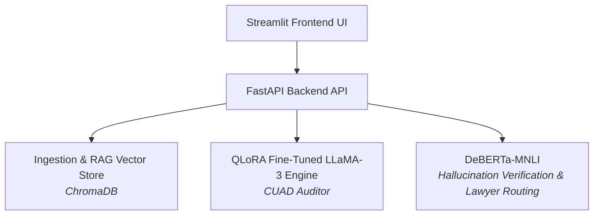

# LegalSeva — AI-Powered Legal Contract Auditor & Compliance Platform

**LegalSeva** is an enterprise-grade contract auditing and legal intelligence platform designed specifically for remote version control, fast execution, and strict regulatory alignment with **EU AI Act Annex III** documentation standards. 

The core engine leverages a 4-bit QLoRA fine-tuned **LLaMA-3-8B** model for legal clause extraction, **ChromaDB** for vector-based Retrieval-Augmented Generation (RAG), and a **DeBERTa-large-mnli** NLI verification guardrail to actively prevent legal hallucinations and route high-risk agreements to human legal counsel.

---

## Architectural Overview


---

## Key Features & Engineering Highlights

* **Fine-Tuned Clause Extraction:** QLoRA 4-bit fine-tuned LLaMA-3-8B model trained against the **CUAD** (Contract Understanding Atticus Dataset) across 41 risk categories (ROUGE-L: ~0.4119).
* **NLI Hallucination Verification:** Integrates `DeBERTa-large-mnli` to verify generated summaries against source text, maintaining factual hallucination rates ≤ 0.15.* **Automated Lawyer-Routing Policy:** Automatically flags contracts with unverified claims (`hallucination_rate > 0.20`) or self-consistency conflicts, marking them with `mandatory_lawyer_review = True`.
* **Source Sentence Attribution:** Calculates TF-IDF and embedding similarity to attribute claims back to the exact top-3 contract source clauses.
* **EU AI Act Annex III Package:** Fully compliant high-risk AI documentation (`COMPLIANCE_ANNEX_III.md`), mandatory non-legal advice disclaimer banners, and audit log generation.
* **MLOps Lineage & Privacy Tracking:** Logs contract statistics, clause distributions, and evaluation runs without storing raw user contract text (`src/mlops_tracker.py`).

---

## Tech Stack

* **Large Language Model:** LLaMA-3-8B (QLoRA 4-bit quantized)
* **NLI Guardrails:** DeBERTa-large-mnli
* **Vector Store / RAG:** ChromaDB
* **API Framework:** FastAPI & Uvicorn
* **Frontend Interface:** Streamlit
* **Containerization:** Docker
* **Language & MLOps:** Python 3.10+, PyTorch, HuggingFace Transformers, MLflow

---

## Repository Structure

```text
legal-llm-contract-review/
├── src/
│   ├── attribution.py        # Sentence attribution & similarity scoring
│   ├── chunking.py           # Contract text chunking pipeline
│   ├── config.py             # System configuration parameters
│   ├── data_loader.py        # Data loading utilities
│   ├── dataset_builder.py   # CUAD dataset formatting pipeline
│   ├── guardrails.py        # Lawyer routing and hallucination policy
│   ├── main.py               # FastAPI application endpoints
│   ├── prepare_cuad.py       # Pre-processing scripts for CUAD
│   ├── preprocess.py         # Text cleaning and normalization
│   ├── rag_engine.py         # RAG query retrieval pipeline
│   └── vector_store.py       # ChromaDB vector store wrapper
├── app.py                    # Streamlit web user interface
├── COMPLIANCE_ANNEX_III.md   # EU AI Act Annex III compliance documentation
├── Dockerfile                # Production container deployment definition
├── .dockerignore             # Docker build exclusion rules
├── .gitignore                # Git repository tracking rules
├── requirements.txt          # Python dependencies
├── evaluate_cuad.py          # CUAD evaluation suite
├── evaluate_cuad_accuracy.py # Accuracy evaluation script
├── evaluate_summarization.py# ROUGE & NLI summarization benchmarks
├── inference.py              # CLI inference tester
├── ingest_cuad.py            # Vector ingestion script
├── train_qlora.py            # QLoRA fine-tuning pipeline
└── verification.py           # NLI verification tests
